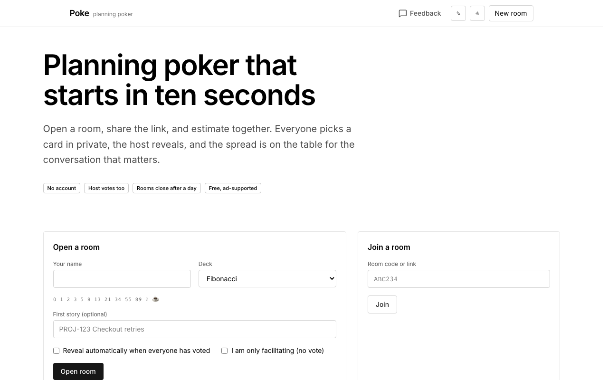
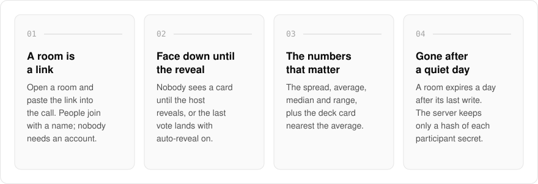
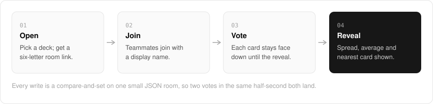
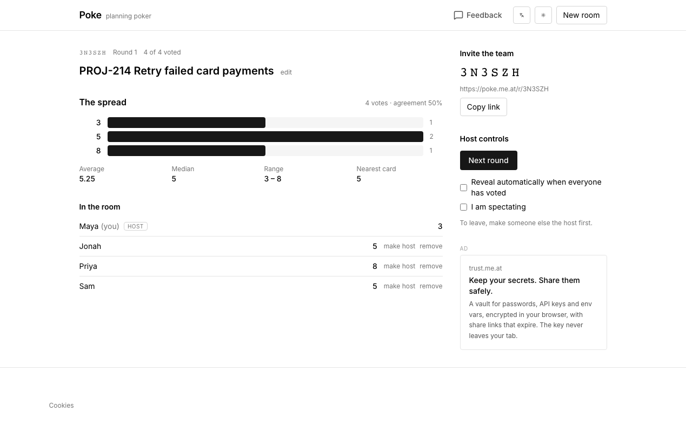

  <picture>
    <source media="(prefers-color-scheme: dark)" srcset=".github/assets/hero-dark.png">
    
  </picture>

<h1 align="center">poke.me.at</h1>

<strong>Planning poker that starts in ten seconds.</strong>

  
  
  
  

  <a href="#features">Features</a> ·
  <a href="#how-it-works">How it works</a> ·
  <a href="#screenshots">Screenshots</a> ·
  <a href="#built-with">Built with</a>

Every planning-poker tool I have used wanted an account before it would let me share a link, and most of them anchored the room by showing the first vote. I built poke.me.at the way I want a stand-up to go: open a room, paste the link into the call, everyone picks a card in private, reveal, talk about the outliers, next story.

  <picture>
    <source media="(prefers-color-scheme: dark)" srcset=".github/assets/overview-dark.svg">
    
  </picture>

## Why poke.me.at

| The usual tool | poke.me.at |
| --- | --- |
| Sign up before you can share | A room is a link; join with a name |
| Votes visible as they land | Cards stay face down until the reveal |
| The host only facilitates | The host votes too, or spectates for a round |
| Rooms pile up in an account | A room expires a day after it goes quiet; nothing is kept |

## Features

- **Five decks**: Fibonacci, modified Fibonacci, T-shirt sizes, powers of two, linear 1 to 10. Every deck has a question mark and a coffee cup.
- **Private votes, one reveal**: nobody sees anyone else's card until the host reveals, or until the last vote lands with auto-reveal on.
- **The numbers that matter**: the spread, the average, the median, the range, and the deck card nearest the average.
- **Host controls**: edit the story, reveal, next round, hand hosting over, remove a stray participant.
- **Spectators**: step out for a round without leaving the room.
- **Round history**: earlier rounds and their outcomes stay on the side panel for the retro.
- **Concurrency-safe**: every write is a compare-and-set, so two phones voting in the same half-second both land.
- **Free, ad-supported**: one clearly labelled ad slot per page. The default is a first-party card for another me.at product; a third-party network, if enabled, is asked for non-personalised ads only.

## How it works

  <picture>
    <source media="(prefers-color-scheme: dark)" srcset=".github/assets/flow-dark.svg">
    
  </picture>

A room is one small JSON object in a key-value store with a day-long sliding expiry, renewed by every write. Each participant holds a minted secret in their own browser; the server keeps only its hash. The page polls the room while the tab is visible and writes each action's response straight into the view, so your own card is on screen the moment you tap it.

## Screenshots

<table>
  <tr>
    <td width="50%"><picture><source media="(prefers-color-scheme: dark)" srcset=".github/assets/hero-dark.png"></picture> The landing page: open a room or join one with its code.</td>
    <td width="50%"><picture><source media="(prefers-color-scheme: dark)" srcset=".github/assets/room-dark.png"></picture> A revealed round: the spread, the summary figures and every vote, with host controls on the side.</td>
  </tr>
</table>

## Built with

  
  
  
  
  

- Next.js 16 (App Router), React 19, TypeScript
- Tailwind CSS 4
- oRPC with TanStack Query
- Upstash Redis (memory store in development)

## Part of the me.at family

poke.me.at is one of my [`*.me.at`](https://me.at) apps. They share one design system, one account, and one app shell. Development happens in a private monorepo; this repository is the project's public-facing home.

## License

Source-available. See [LICENSE](LICENSE).
